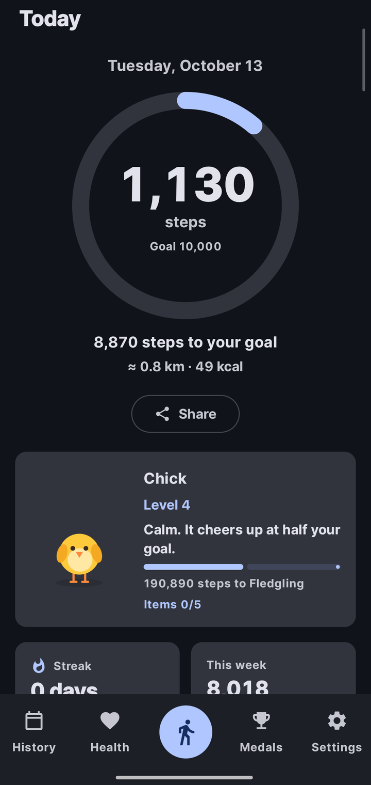
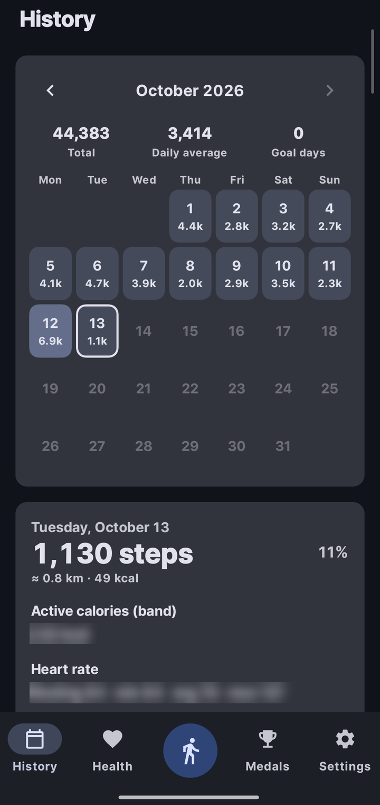
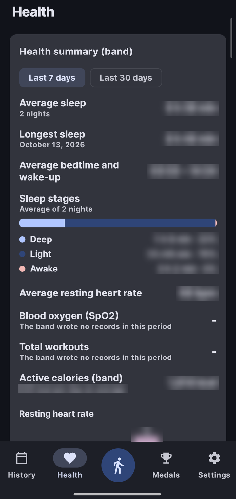
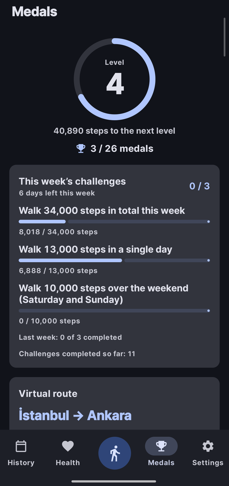
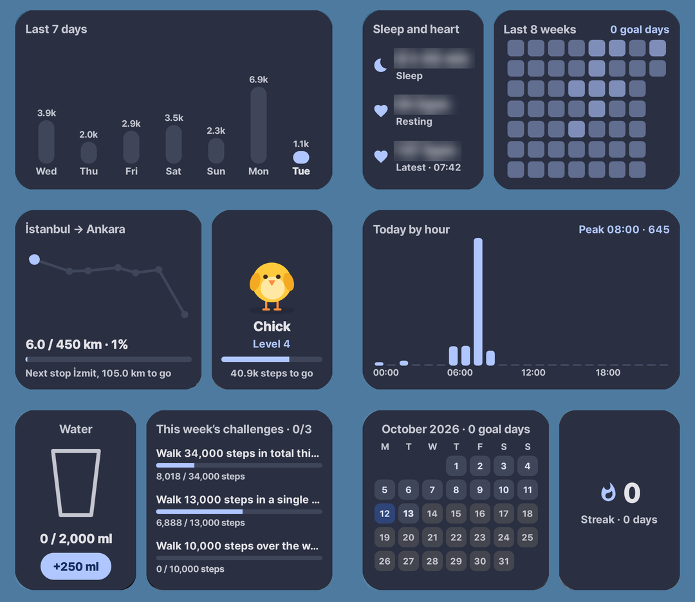
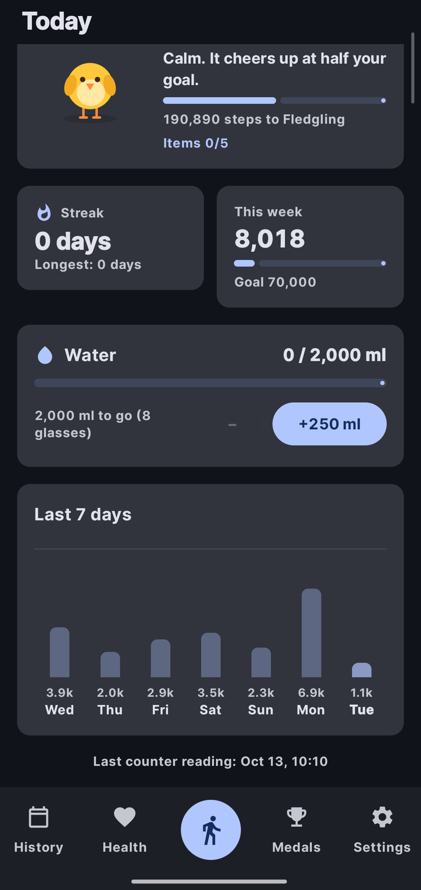
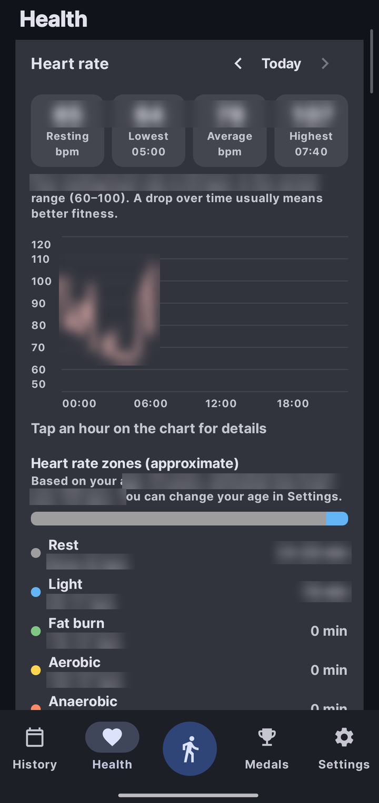
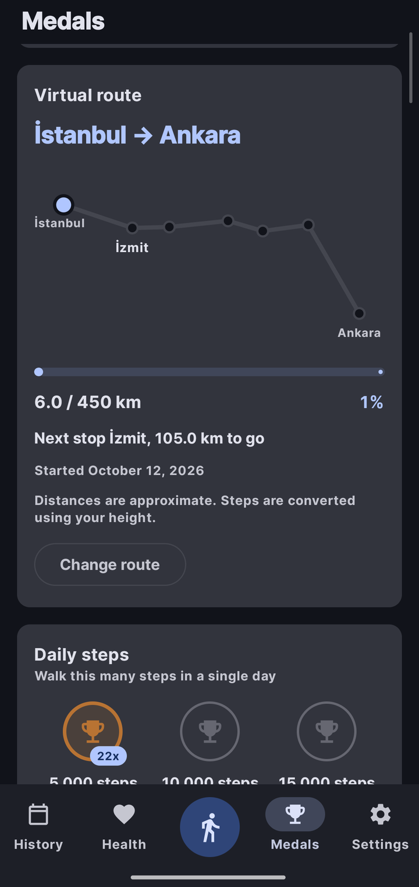

<p align="center">
  
</p>

<h1 align="center">FitWren – Step Counter &amp; Health</h1>

<p align="center">
  A private step counter and health tracker for Android.<br>
  No account, no ads, no tracking. Your data never leaves your phone.
</p>

<p align="center">
  <a href="../../releases/latest"></a>
  
  <a href="LICENSE"></a>
</p>

<p align="center">
  <a href="https://apps.obtainium.imranr.dev/redirect?r=obtainium://app/%7B%22id%22%3A%22com.dordeorz.adimsayar%22%2C%22url%22%3A%22https%3A%2F%2Fgithub.com%2FDorDeorz%2Fadimsayar%22%2C%22author%22%3A%22DorDeorz%22%2C%22name%22%3A%22FitWren%22%7D"></a>
</p>

<p align="center">
  <b>English</b> · <a href="README.tr.md">Türkçe</a>
</p>

---

<p align="center">
  
  
  
  
</p>

## Why FitWren

Many phones ship without a step counter app, or with one that wants an account and sends your data to a server. FitWren counts steps with your phone's own sensor, stores everything on the device and works without any sign-in.

- **Accurate.** Reads the hardware step counter and checks it against the step detector, so a frozen sensor is noticed and fixed without a reboot.
- **Battery friendly.** No always-on service by default. The counter is read now and then and the difference is saved.
- **Private.** No account, no server, no analytics, no ads. The internet is used only when you tap "Check for updates" or sign in to Xiaomi to get your band's key.
- **Works on every Android phone.** Tested on Xiaomi (HyperOS) and Samsung (One UI), the two brands that are hardest on background apps.

## Features

### Today
- Progress ring toward your daily goal, steps left, distance and calories
- Streak, weekly progress and the last 7 days
- Water tracking with a goal suggested from your weight
- A little wren that grows with your steps ([meet the wren](#meet-the-wren))
- Share your day as an image

### History
- Monthly calendar colored by goal, hour-by-hour chart for any day
- Records: best day, week and month, longest streak
- Yearly summary
- Streak freeze: two per month, so one missed day doesn't break your streak

### Health (optional, with a fitness band or watch)
- Reads steps from bands such as the Mi Band through Health Connect. Hours the band counted use the band, other hours use the phone, so no step is counted twice.
- Sleep with stages, heart rate with zones, resting heart rate trend, SpO₂, workouts and active calories
- Weight log with BMI and a chart
- A setup guide that shows which apps write to Health Connect

### Medals and goals
- Medals for daily steps, streaks, weekly goals, total distance and early walks. Once earned, a medal stays.
- Levels, three weekly challenges picked from your own history
- Virtual routes: walk from Istanbul to Ankara or along the Camino with your steps

### 13 home-screen widgets

Today's steps, 7-day chart, streak and week, monthly calendar, today by hour, heatmap, sleep and heart, the wren, water (add a glass with one tap), virtual route, weekly challenges, weight and daily summary.

Every widget resizes to fit, follows your wallpaper colors (Material You) or the app theme, and has adjustable background transparency. Tapping a widget opens the matching page.

<p align="center">
  
</p>

### And also
- Daily goal, weekly goal, first day of week, km or miles
- Optional notifications: goal reached, goal almost reached, evening streak reminder, weekly summary, water and weight reminders
- Light, dark or system theme
- 12 languages: English, Turkish, German, Spanish, French, Italian, Portuguese, Russian, Arabic, Japanese, Chinese and Korean
- Export and import as CSV. Import also reads Samsung Health, Mi Fitness, Mi Fit and Google Fit exports.

<p align="center">
  
  
  
</p>

## Meet the wren

Your steps raise a little bird. It lives on the Today screen and in its own widget. Nothing about it is stored: its look is worked out from your step history every time.

### It grows with your total steps

<p align="center"></p>

| Stage | Level | Total steps |
|---|---|---|
| Egg | 0 | from the start. A crack appears halfway to hatching. |
| Just hatched | 1 | 25,000 |
| Chick | 3 | 150,000 |
| Fledgling | 6 | 525,000. It gets a tail. |
| Bird | 10 | 1,375,000. It gets a crest and a longer tail. |
| Wise bird | 15 | 3,000,000. The crest turns gold. |

The card shows how many steps are left to the next level and stage, and celebrates the day you level up.

### Its mood follows your day

<p align="center"></p>

1. **Sleepy:** before 07:00, or under 10% of your daily goal.
2. **Sad:** you missed yesterday's goal and today is still under half. A streak freeze on yesterday keeps it from being sad.
3. **Calm:** under half of your goal.
4. **Happy:** half of your goal or more. It blushes.
5. **Thrilled:** goal reached. Wings up, sparkles around it.

### Medals bring it items

<p align="center"></p>

| Item | How to earn it |
|---|---|
| Scarf | A 7-day streak |
| Medal | Reach your weekly goal 4 times |
| Sun | Early walks on 7 days (with the HyperOS record on) |
| Party hat | 20,000 steps in one day |
| Crown | 1 million steps in total. It replaces the party hat. |

Medals are permanent, so items stay once earned. Tap the bird in the app and it hops and flaps its wings; now and then it blinks. The widget shows the same bird without animation.

## Install

1. Download the latest APK from [Releases](../../releases/latest).
2. Open it on your phone and allow installing from this source.
3. On first launch, allow "Physical activity".
4. On Xiaomi phones, turn on Settings → Step source → "Use the HyperOS step record" for counting without a notification.

Updates: Settings → About → "Check for updates" asks you to confirm, then downloads the new APK from GitHub and opens Android's installer. If you installed FitWren from Obtainium or another store, update it there. You can also track releases with [Obtainium](https://github.com/ImranR98/Obtainium).

## Privacy

FitWren stores daily step totals, water, weight and your settings on the phone. Nothing is sent anywhere.

The only network request is made when you tap "Check for updates": the app reads the latest version number from `api.github.com/repos/DorDeorz/adimsayar/releases/latest`, and if you tap again and confirm, it downloads the APK from GitHub Releases. Nothing about you or your steps is sent with it.

If you tap "Get the key with your Xiaomi account" on the band setup screen, the app opens Xiaomi's own sign-in page (`account.xiaomi.com`) and then asks Xiaomi's server (`api.io.mi.com`) for the list of your devices, to read the band's address and key. FitWren never sees your password. The key is stored only on the phone, and nothing about your steps is sent.

Health Connect is used only if you turn on "Use band steps", and only for reading. FitWren never writes to Health Connect.

<details>
<summary>Permissions and why they are needed</summary>

| Permission | Why |
|---|---|
| `ACTIVITY_RECOGNITION` | Read the step sensors (Android 10+) |
| `miui.permission.READ_STEPS` | Read the HyperOS step record on Xiaomi |
| `FOREGROUND_SERVICE`, `FOREGROUND_SERVICE_HEALTH` | Read the counter for a few seconds in the background, and the optional "Keep counting in the background" mode |
| `POST_NOTIFICATIONS` | Optional reminders and goal notifications |
| `RECEIVE_BOOT_COMPLETED` | Restore schedules after a reboot |
| `SCHEDULE_EXACT_ALARM` | Switch to the new day at midnight |
| `INTERNET` | Only the update check and download, and the Xiaomi sign-in for the band key, both started by you |
| `BLUETOOTH_SCAN`, `BLUETOOTH_CONNECT` | Optional direct connection to a Xiaomi band |
| `REQUEST_INSTALL_PACKAGES` | Open Android's installer for a downloaded update |
| `health.READ_*` | Optional band data from Health Connect, read only |

</details>

## How steps are counted

<details>
<summary>Technical details</summary>

The only real data is the **step total per day**. Medal progress, levels, streaks and records are calculated from it.

**Phone sensor (default).** Android's `TYPE_STEP_COUNTER` reports the steps since the phone was turned on. FitWren reads it when the app opens, when a widget updates, every ~15 minutes with `JobScheduler`, and after a reboot or time change. The difference since the last reading is split across days and hours and added to the totals. Android 9+ gives sensors only to active apps, so the background reading runs inside a short foreground service that finishes in under 10 seconds and usually shows no notification.

**Frozen sensor check.** On some phones (Samsung especially) the counter can stop. While the app is open, the step detector is also read. If the detector saw at least 50 steps in two minutes and the counter didn't move, FitWren warns you and re-registers the sensor.

**HyperOS step record (Xiaomi, optional).** HyperOS records steps with its own service even when no app is running. With the switch on, daily and hourly totals come from this record, including walk/run split and past days.

**Keep counting in the background (optional).** For phones that stop counting when the app is killed, a quiet foreground service keeps the counter registered and batches events every 60 seconds.

**Fitness band (optional).** Each Health Connect source is asked for its own daily and hourly totals. The largest source per hour is used, never a sum, and band hours replace phone hours. Band totals live in their own table, so turning the switch off brings the phone's numbers back.

**Battery help.** Some brands kill background apps aggressively. FitWren never forces the battery exemption. If your brand is known for it and the exemption is not granted, a dismissible card shows the steps for your phone.

</details>

## Build from source

You need the Android SDK and JDK 21.

```
./gradlew assembleDebug
./gradlew testDebugUnitTest
```

Built with Kotlin, Jetpack Compose, Material 3, Glance and Room. `minSdk 23`, `targetSdk 36`.

```
app/src/main/java/com/dordeorz/adimsayar/
├── sensor/       step sensors, live counter, frozen sensor check
├── band/         direct Bluetooth connection to Xiaomi bands (based on Gadgetbridge)
├── data/         Room database, step math, HyperOS and Health Connect sources, medals, routes
├── background/   periodic reading, midnight alarm, services, reminders
├── widget/       13 Glance widgets
└── ui/           Compose screens, theme, battery help
```

Release APKs are built and signed by GitHub Actions with a key kept in repository secrets. Without those secrets (in a fork, for example) the APK is signed with a temporary debug key. Version history: [CHANGELOG.md](CHANGELOG.md) (Turkish; the in-app release notes are translated). How to publish a release: [docs/RELEASING.md](docs/RELEASING.md).

## License

[AGPL-3.0](LICENSE). FitWren was MIT licensed up to 0.9.6. From 0.10.0 it is AGPL-3.0, because the direct band connection (`app/src/main/java/com/dordeorz/adimsayar/band/`) is a Kotlin rewrite of [Gadgetbridge](https://codeberg.org/Freeyourgadget/Gadgetbridge)'s Xiaomi support (Copyright © Gadgetbridge contributors, AGPL-3.0). FitWren was formerly called AdımSayar; the package name `com.dordeorz.adimsayar` stays the same, so updates and your data are not affected.

Built with [Claude Code](https://claude.com/claude-code). Sister project: [Kronometre](https://github.com/DorDeorz/kronometre).
