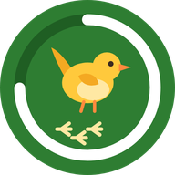
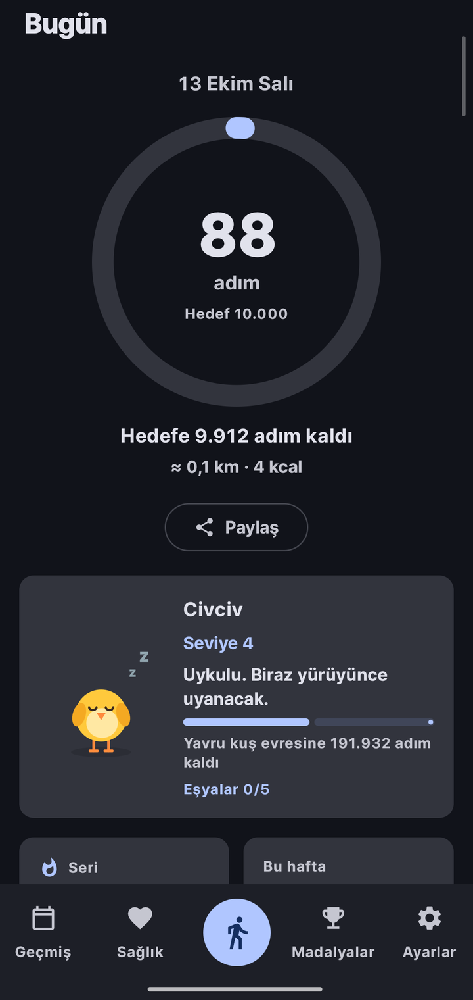
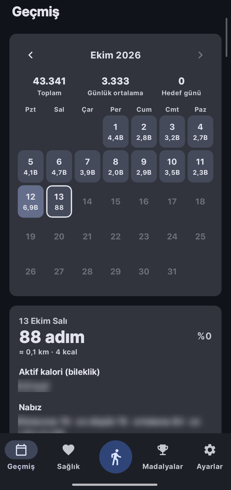
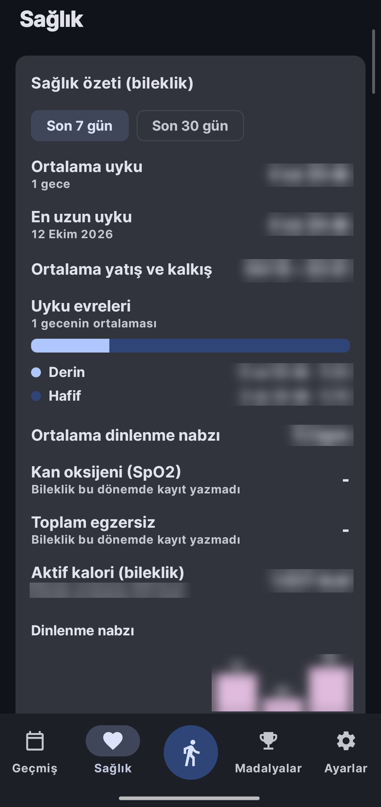
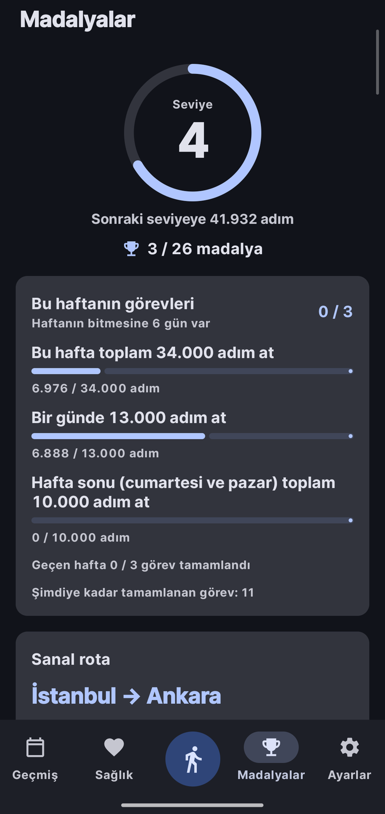
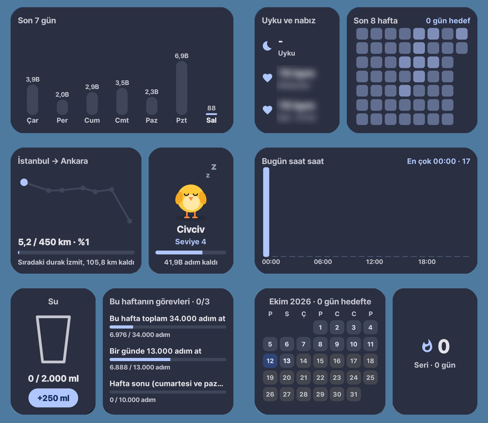
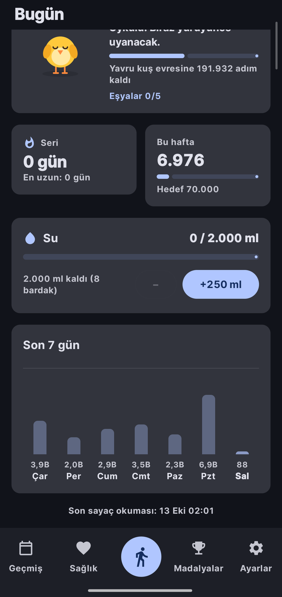
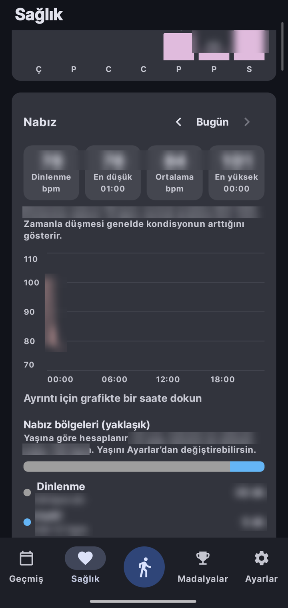
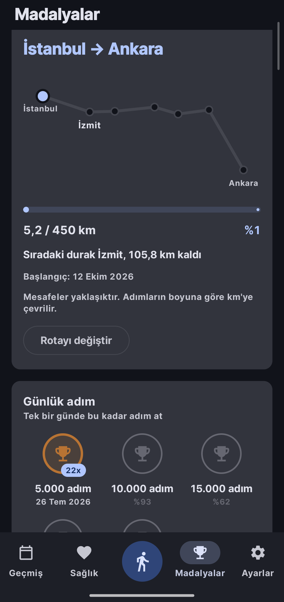

<p align="center">
  
</p>

<h1 align="center">FitWren – Adım Sayar &amp; Sağlık</h1>

<p align="center">
  Android için gizliliğe saygılı adım sayar ve sağlık takibi.<br>
  Hesap yok, reklam yok, takip yok. Verilerin telefonundan çıkmaz.
</p>

<p align="center">
  <a href="../../releases/latest"></a>
  
  <a href="LICENSE"></a>
</p>

<p align="center">
  <a href="https://apps.obtainium.imranr.dev/redirect?r=obtainium://app/%7B%22id%22%3A%22com.dordeorz.adimsayar%22%2C%22url%22%3A%22https%3A%2F%2Fgithub.com%2FDorDeorz%2Fadimsayar%22%2C%22author%22%3A%22DorDeorz%22%2C%22name%22%3A%22FitWren%22%7D"></a>
</p>

<p align="center">
  <a href="README.md">English</a> · <b>Türkçe</b>
</p>

---

<p align="center">
  
  
  
  
</p>

## Neden FitWren

Birçok telefonda adım sayar uygulaması yok, olanlar da çoğu zaman hesap istiyor ve verini bir sunucuya gönderiyor. FitWren adımları telefonun kendi sensörüyle sayar, her şeyi cihazda saklar ve giriş yapmadan çalışır.

- **Doğru sayar.** Donanım adım sayacını okur ve adım dedektörüyle karşılaştırır. Sensör donarsa bunu fark eder ve telefonu yeniden başlatmana gerek kalmadan düzeltir.
- **Pili yormaz.** Varsayılan olarak sürekli çalışan bir servis yoktur. Sayaç ara ara okunur ve fark kaydedilir.
- **Gizlidir.** Hesap, sunucu, analitik ve reklam yoktur. İnternet yalnızca "Güncellemeleri kontrol et"e dokunduğunda ya da bilekliğin anahtarı için Xiaomi'ye giriş yaptığında kullanılır.
- **Her Android telefonda çalışır.** Arka plan uygulamalarına en sert davranan iki markada, Xiaomi (HyperOS) ve Samsung'da (One UI) test edildi.

## Özellikler

### Bugün
- Günlük hedefe göre ilerleme halkası, kalan adım, mesafe ve kalori
- Seri, haftalık ilerleme ve son 7 gün
- Kilona göre önerilen hedefle su takibi
- Adımlarınla büyüyen küçük bir kuş ([civcivle tanış](#civcivle-tanış))
- Günün özetini resim olarak paylaşma

### Geçmiş
- Hedefe göre renklenen aylık takvim, her gün için saat saat grafik
- Rekorlar: en iyi gün, hafta ve ay, en uzun seri
- Yıllık özet
- Seri jokeri: ayda iki hak, kaçırdığın bir gün serini bozmaz

### Sağlık (isteğe bağlı, bileklik ya da saatle)
- Mi Band gibi bilekliklerin adımlarını Health Connect üzerinden okur. Bilekliğin saydığı saatlerde bileklik, diğer saatlerde telefon sayılır. Hiçbir adım iki kez sayılmaz.
- Evreleriyle uyku, bölgeleriyle nabız, dinlenme nabzı eğilimi, kan oksijeni, egzersizler ve aktif kalori
- Vücut kitle endeksi ve grafikle kilo kaydı
- Health Connect'e hangi uygulamaların veri yazdığını gösteren kurulum rehberi

### Madalyalar ve hedefler
- Günlük adım, seri, haftalık hedef, toplam yol ve erken yürüyüş madalyaları. Kazandığın madalya kalır.
- Seviyeler ve geçmişine göre seçilen üç haftalık görev
- Sanal rotalar: adımlarınla İstanbul'dan Ankara'ya ya da Camino boyunca yürü

### 13 ana ekran widget'ı

Bugünün adımı, 7 günlük tablo, seri ve hafta, aylık takvim, saat saat bugün, ısı haritası, uyku ve nabız, çalıkuşu, su (tek dokunuşla bardak ekler), sanal rota, haftalık görevler, kilo ve günün özeti.

Her widget boyutuna göre düzenini değiştirir, duvar kağıdının renklerini (Material You) ya da uygulamanın temasını kullanır ve arka plan saydamlığı ayarlanabilir. Widget'a dokununca ilgili sayfa açılır.

<p align="center">
  
</p>

### Ve ayrıca
- Günlük hedef, haftalık hedef, haftanın ilk günü, km ya da mil
- İsteğe bağlı bildirimler: hedefe ulaşınca, hedefe yaklaşınca, akşam seri hatırlatması, haftalık özet, su ve kilo hatırlatmaları
- Açık, koyu ya da sistem teması
- 12 dil: Türkçe, İngilizce, Almanca, İspanyolca, Fransızca, İtalyanca, Portekizce, Rusça, Arapça, Japonca, Çince ve Korece
- CSV ile dışa ve içe aktarma. İçe aktarma Samsung Health, Mi Fitness, Mi Fit ve Google Fit dışa aktarımlarını da okur.

<p align="center">
  
  
  
</p>

## Civcivle tanış

Adımların küçük bir kuşu büyütür. Bugün ekranında ve kendi widget'ında yaşar. Hakkında hiçbir şey saklanmaz: görünüşü her seferinde adım geçmişinden hesaplanır.

### Toplam adımınla büyür

<p align="center"></p>

| Evre | Seviye | Toplam adım |
|---|---|---|
| Yumurta | 0 | başlangıçtan. Yolun yarısında kabukta çatlak belirir. |
| Yumurtadan yeni çıktı | 1 | 25.000 |
| Civciv | 3 | 150.000 |
| Yavru kuş | 6 | 525.000. Kuyruğu çıkar. |
| Kuş | 10 | 1.375.000. Tepeliği çıkar, kuyruğu uzar. |
| Bilge kuş | 15 | 3.000.000. Tepeliği altın rengi olur. |

Kart, sonraki seviyeye ve evreye kaç adım kaldığını gösterir ve seviye atladığın günü kutlar.

### Ruh hali gününe göre değişir

<p align="center"></p>

1. **Uykulu:** saat 07:00'den önce ya da günlük hedefinin %10'unun altındayken.
2. **Üzgün:** dün hedefi kaçırdıysan ve bugün hâlâ yarının altındaysan. Düne joker kullanırsan üzülmez.
3. **Sakin:** hedefin yarısının altında.
4. **Neşeli:** hedefin yarısı ya da fazlası. Yanakları kızarır.
5. **Coşkulu:** hedefe ulaştın. Kanatlar havada, etrafında parıltılar.

### Madalyalar ona eşya getirir

<p align="center"></p>

| Eşya | Nasıl kazanılır |
|---|---|
| Atkı | 7 günlük seri |
| Madalya | Haftalık hedefe 4 kez ulaşmak |
| Güneş | 7 gün erken yürüyüş (HyperOS kaydı açıkken) |
| Parti şapkası | Bir günde 20.000 adım |
| Taç | Toplam 1 milyon adım. Parti şapkasının yerine geçer. |

Madalyalar kalıcı olduğu için kazanılan eşya da kalır. Uygulamada kuşa dokununca zıplar ve kanat çırpar, ara sıra da göz kırpar. Widget aynı kuşu animasyonsuz gösterir.

## Kurulum

1. [Releases](../../releases/latest) sayfasından son APK'yı indir.
2. Telefonda aç ve bu kaynaktan yüklemeye izin ver.
3. İlk açılışta "Fiziksel etkinlik" iznini ver.
4. Xiaomi telefonlarda bildirimsiz sayım için Ayarlar → Adım kaynağı → "HyperOS adım kaydını kullan"ı aç.

Güncellemeler: Ayarlar → Hakkında → "Güncellemeleri kontrol et" önce onay ister, sonra yeni APK'yı GitHub'dan indirir ve Android'in kurulum ekranını açar. FitWren'i Obtainium ya da başka bir mağazadan kurduysan oradan güncelle. Sürümleri [Obtainium](https://github.com/ImranR98/Obtainium) ile de takip edebilirsin.

## Gizlilik

FitWren günlük adım toplamlarını, suyu, kiloyu ve ayarlarını telefonda saklar. Hiçbir şey bir yere gönderilmez.

Tek ağ isteği "Güncellemeleri kontrol et"e dokunduğunda yapılır: uygulama son sürüm numarasını `api.github.com/repos/DorDeorz/adimsayar/releases/latest` adresinden okur, tekrar dokunup onaylarsan APK'yı GitHub Releases'tan indirir. Bu isteklerle senin ya da adımlarınla ilgili hiçbir bilgi gönderilmez.

Bileklik kurulum ekranında "Xiaomi hesabıyla anahtarı al"a dokunursan uygulama Xiaomi'nin kendi giriş sayfasını (`account.xiaomi.com`) açar, sonra bilekliğin adresini ve anahtarını okumak için Xiaomi sunucusundan (`api.io.mi.com`) cihaz listeni ister. Şifreni FitWren görmez. Anahtar yalnızca telefonda saklanır, adımlarınla ilgili hiçbir şey gönderilmez.

Health Connect yalnızca "Bileklik adımlarını kullan" açıksa ve yalnızca okumak için kullanılır. FitWren Health Connect'e hiçbir şey yazmaz.

<details>
<summary>İzinler ve neden gerektikleri</summary>

| İzin | Neden |
|---|---|
| `ACTIVITY_RECOGNITION` | Adım sensörlerini okumak (Android 10+) |
| `miui.permission.READ_STEPS` | Xiaomi'de HyperOS adım kaydını okumak |
| `FOREGROUND_SERVICE`, `FOREGROUND_SERVICE_HEALTH` | Sayacı arka planda birkaç saniyede okumak ve isteğe bağlı "Arka planda sürekli say" |
| `POST_NOTIFICATIONS` | İsteğe bağlı hatırlatmalar ve hedef bildirimleri |
| `RECEIVE_BOOT_COMPLETED` | Telefon açılınca zamanlamaları yeniden kurmak |
| `SCHEDULE_EXACT_ALARM` | Gece yarısı yeni güne geçmek |
| `INTERNET` | Yalnızca senin başlattığın güncelleme kontrolü ve indirmesi, bir de bileklik anahtarı için Xiaomi girişi |
| `BLUETOOTH_SCAN`, `BLUETOOTH_CONNECT` | İsteğe bağlı Xiaomi bileklik bağlantısı |
| `REQUEST_INSTALL_PACKAGES` | İndirilen güncelleme için Android'in kurulum ekranını açmak |
| `health.READ_*` | İsteğe bağlı bileklik verisi, yalnızca okuma |

</details>

## Adımlar nasıl sayılıyor

<details>
<summary>Teknik ayrıntılar</summary>

Tek gerçek veri **gün başına toplam adım**dır. Madalya ilerlemesi, seviyeler, seriler ve rekorlar bundan hesaplanır.

**Telefonun sensörü (varsayılan).** Android'in `TYPE_STEP_COUNTER` sensörü telefon açıldığından beri atılan adımı verir. FitWren onu uygulama açılınca, widget güncellenirken, `JobScheduler` ile yaklaşık 15 dakikada bir ve yeniden başlatma ya da saat değişimi sonrasında okur. Son okumadan bu yana olan fark günlere ve saatlere bölünüp toplamlara eklenir. Android 9+ sensörleri yalnızca etkin uygulamalara verdiği için arka plan okuması 10 saniyeden kısa süren bir ön plan servisinde yapılır; çoğu zaman bildirim bile görünmez.

**Donma kontrolü.** Bazı telefonlarda (özellikle Samsung'da) sayaç durabiliyor. Uygulama açıkken adım dedektörü de dinlenir. İki dakikada dedektör en az 50 adım görmüş ama sayaç ilerlememişse FitWren seni uyarır ve sensöre yeniden bağlanır.

**HyperOS adım kaydı (Xiaomi, isteğe bağlı).** HyperOS, hiçbir uygulama çalışmasa da adımları kendi servisiyle kaydeder. Anahtar açıkken günlük ve saatlik toplamlar bu kayıttan gelir; yürüyüş/koşu ayrımı ve geçmiş günler de dahil.

**Arka planda sürekli say (isteğe bağlı).** Uygulama kapatılınca saymayı bırakan telefonlar için sessiz bir ön plan servisi sayacı kayıtlı tutar ve olayları 60 saniyede bir toplu alır.

**Bileklik (isteğe bağlı).** Health Connect'teki her kaynaktan ayrı günlük ve saatlik toplam istenir. Her saat için en büyük kaynak alınır, toplanmaz; bilekliğin saatleri telefonun saatlerinin yerine geçer. Bileklik toplamları ayrı tabloda tutulur, anahtar kapatılınca telefonun sayıları geri gelir.

**Pil yardımı.** Bazı markalar arka plan uygulamalarını agresif biçimde kapatır. FitWren pil muafiyetini zorla istemez. Marka bununla biliniyorsa ve muafiyet verilmemişse, telefonuna özel adımları gösteren kapatılabilir bir kart çıkar.

</details>

## Kaynaktan derleme

Android SDK ve JDK 21 gerekir.

```
./gradlew assembleDebug
./gradlew testDebugUnitTest
```

Kotlin, Jetpack Compose, Material 3, Glance ve Room ile yazıldı. `minSdk 23`, `targetSdk 36`.

```
app/src/main/java/com/dordeorz/adimsayar/
├── sensor/       adım sensörleri, canlı sayaç, donma kontrolü
├── band/         Xiaomi bilekliklere doğrudan Bluetooth bağlantısı (Gadgetbridge tabanlı)
├── data/         Room veritabanı, adım hesabı, HyperOS ve Health Connect kaynakları, madalyalar, rotalar
├── background/   periyodik okuma, gece yarısı alarmı, servisler, hatırlatmalar
├── widget/       13 Glance widget'ı
└── ui/           Compose ekranları, tema, pil yardımı
```

Release APK'ları GitHub Actions'ta, depo Secret'larında saklanan bir anahtarla derlenip imzalanır. Bu Secret'lar yoksa (örneğin bir fork'ta) APK geçici bir debug anahtarıyla imzalanır. Sürüm geçmişi: [CHANGELOG.md](CHANGELOG.md). Yeni sürüm yayınlama: [docs/RELEASING.md](docs/RELEASING.md).

## Lisans

[AGPL-3.0](LICENSE). FitWren 0.9.6'ya kadar MIT lisanslıydı. 0.10.0'dan itibaren AGPL-3.0, çünkü bilekliğe doğrudan bağlantı (`app/src/main/java/com/dordeorz/adimsayar/band/`) [Gadgetbridge](https://codeberg.org/Freeyourgadget/Gadgetbridge)'in Xiaomi kodunun Kotlin'e yeniden yazılmış hâlidir (Telif © Gadgetbridge katkıcıları, AGPL-3.0). FitWren'in eski adı AdımSayar'dı; paket adı `com.dordeorz.adimsayar` aynı kaldı, güncellemeler ve verilerin etkilenmez.

[Claude Code](https://claude.com/claude-code) ile geliştirildi. Kardeş proje: [Kronometre](https://github.com/DorDeorz/kronometre).
